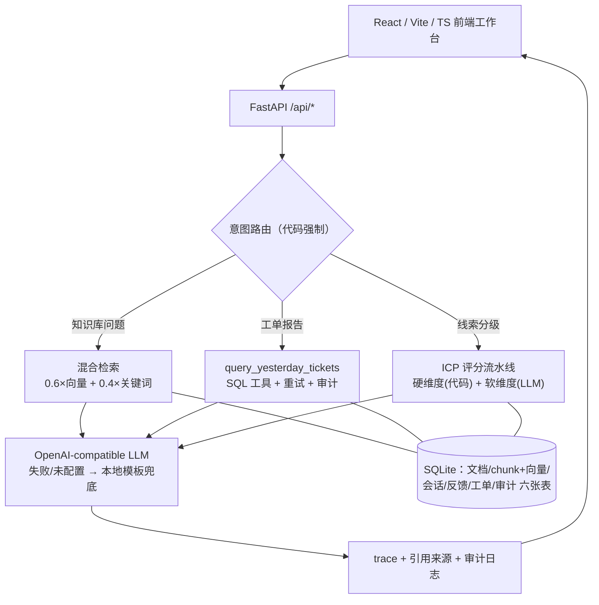

# AI Knowledge Agent Workbench

一个可运行、可直接克隆启动的**企业级 AI Agent 工作台 Demo**：RAG 知识库问答 + 工单运营 Agent + 线索分级 Agent。**FastAPI + React/Vite/TypeScript + SQLite + 向量/关键词混合检索 + OpenAI-compatible LLM（可降级）**，并附一套 API 对等的 **NestJS 第二实现**。

> 全部内容为虚构演示数据，未接入任何真实企业制度、账号权限或生产数据。

## 核心能力

| 模块 | 场景 | 关键技术 |
|------|------|----------|
| 知识库问答 | 上传制度文档，混合检索 + 引用溯源回答 | bge-small-zh 向量 + 中文关键词加权（0.6/0.4），PDF/DOCX/MD 解析 |
| 工单运营 Agent | "总结昨日工单给领导" → SQL 统计 + RAG 规范检索 + 管理层简报 | 意图路由、工具调用、重试、审计日志、trace |
| 线索分级 Agent | 销售线索 → ICP 硬维度评分 + LLM 软维度评分 → 分级 + 销售要点 | 代码编排固定流程、零幻觉可解释、`info_incomplete` 防垃圾进垃圾出 |

三个模块共享同一套底座：本地 ONNX 向量模型（fastembed，无需 GPU）、SQLite 持久化、LLM 未配置时自动降级本地模板（前端徽标显示当前模式）。

## 架构



**核心工程思想：让模型负责"组织语言"，让代码负责"关键路由、数据查询、权限和校验"。** 例如工单报告场景，识别意图后由代码强制调用工具，而不是让模型自主决定——避免"该调工具没调"的不可控行为。

## 快速启动

### 后端（Python 3.10+）

```bash
cd backend
python -m venv .venv
# Windows PowerShell: .venv\Scripts\Activate.ps1
# Git Bash: source .venv/Scripts/activate
pip install -r requirements.txt
python -m uvicorn app.main:app --reload --port 8000
```

首次启动自动写入内置 mock 制度文档并从 `hf-mirror.com` 下载中文向量模型 **BAAI/bge-small-zh-v1.5**（约 90MB，ONNX，无需 GPU）。

### 前端（Node.js 18+）

```bash
cd frontend
npm install
npm run dev
# 打开 http://localhost:5173
```

Windows 下也可直接双击根目录 `start-all.bat` 一键启动前后端。

### NestJS 变体后端（可选）

同一套 API 的 Node/TS 第二实现（内存关键词检索 + Swagger）：

```bash
cd backend
npm install
npm run start:dev
# http://localhost:3001/api/docs
```

## LLM 配置（可选）

复制 `backend/.env.example` 为 `backend/.env`，三项齐全即启用真实 LLM；不配置也能运行（自动降级，前端徽标显示当前模式）。回答始终以检索到的资料为依据并要求列出引用，资料不足时安全拒答。

```ini
OPENAI_BASE_URL=https://api.example.com/v1
OPENAI_API_KEY=sk-xxx
OPENAI_MODEL=gpt-4o-mini
```

## API 概览

| 方法 | 路径 | 说明 |
|------|------|------|
| GET | `/api/health` | 健康检查，附 `vector_ready` / `llm_configured` 能力状态 |
| GET/POST/DELETE | `/api/documents*` | 文档清单 / 上传（≤10MB）/ 删除 |
| POST | `/api/reindex` | 为缺失向量的 chunk 补算 embedding |
| GET | `/api/search?q=...` | 混合检索，返回向量/关键词分项得分 |
| POST | `/api/chat` | RAG 问答（支持多轮会话，引用来自检索命中而非模型输出）|
| POST | `/api/agent` | Agent 统一入口（知识库 / 工单简报路由）|
| GET | `/api/tickets` / `/api/ticket-report` | 工单数据 / 昨日工单管理层简报 |
| GET | `/api/conversations*` | 会话历史（SQLite 持久化，可回看/续接）|
| POST | `/api/feedback` | 回答反馈（up/down）|

## 代码导览

```text
backend/app/main.py        FastAPI 路由、校验边界与启动初始化
backend/app/retrieval.py   fastembed 本地向量 + 关键词混合检索
backend/app/chat.py        RAG 问答编排、trace、引用
backend/app/ticket_agent.py  工单意图路由、工具调用、简报生成
backend/app/ticket_tools.py  Agent 工具封装、重试、审计
backend/app/lead_agent.py    线索评分流水线编排（硬维度代码算分 + 软维度 LLM）
backend/app/knowledge.py   PDF/DOCX/TXT/MD 解析、切分、文档增删
backend/app/db.py          SQLite 持久化（文档/chunk+向量/会话/反馈/工单/审计）
backend/tests/             pytest 工单 Agent 测试
backend/src/               NestJS 第二实现（chat/documents/retrieval/conversations 模块）
frontend/src/main.tsx      单页工作台与 API 调用
```

测试：

```bash
cd backend
.venv/Scripts/python -m pytest tests/ -v      # Python 侧
npm test                                       # NestJS 侧（jest）
```

## 工程细节亮点

- **混合检索可解释**：每条引用同时返回向量分与关键词分项得分，而非只给一个总分。
- **左闭右开时间查询**：`WHERE created_at >= ? AND created_at < ?`，不用 `DATE()` 包字段，保住索引。
- **降级不缺位**：向量模型下载失败 → 纯关键词检索；LLM 未配置/超时 → 本地模板回答；线索软维度评分降级为关键词计数——功能降级但流程完整。
- **审计与 trace**：工具调用写 `tool_audit_logs`，Agent 每步带 trace，回答带引用证据链。

## 生产化方向

向量库升级（Chroma/pgvector/Milvus）、元数据与权限过滤、重排序、召回评估（recall@k / MRR）、流式输出、鉴权、审计合规、敏感信息检测、扫描版 PDF OCR、并发写入锁与数据库连接池。

## License

[MIT](LICENSE)
